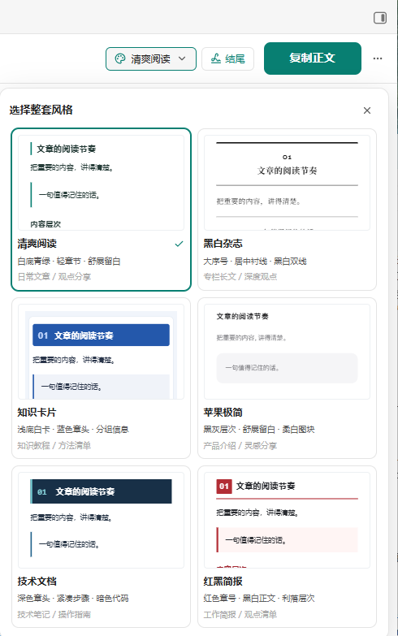
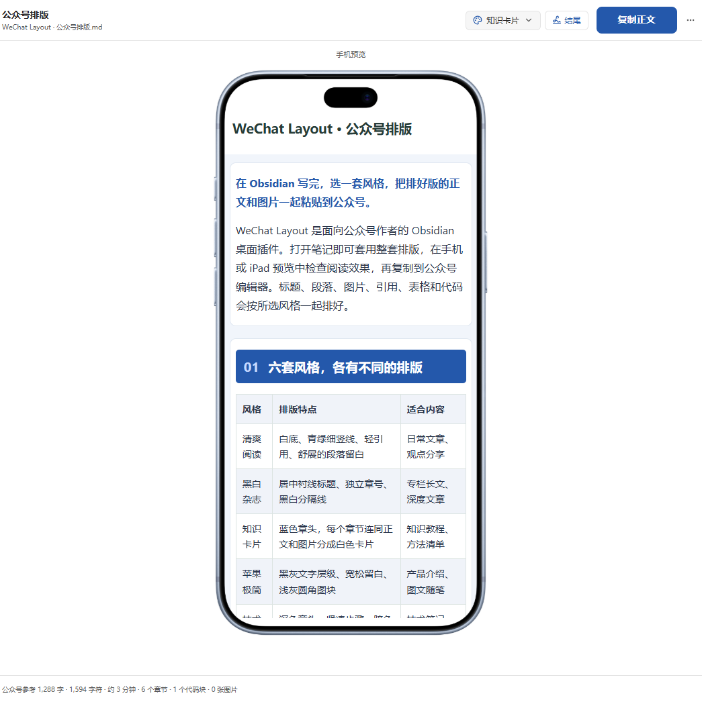
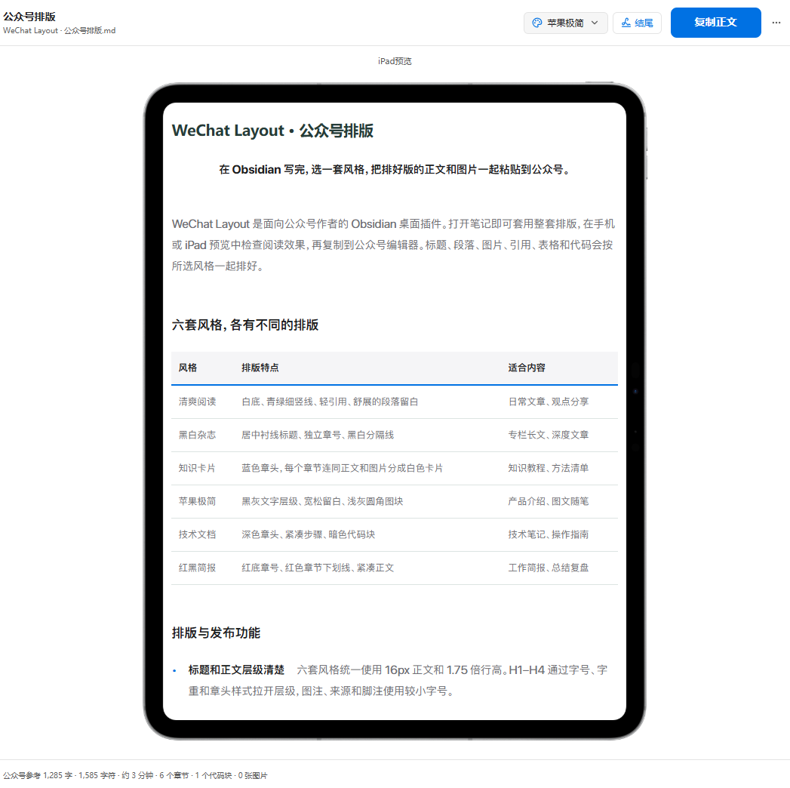

# WeChat Layout

[简体中文](README.zh-CN.md)

**Format an Obsidian note for WeChat Official Accounts and paste the styled text with its images.**

Choose one of six ready-made layouts. Each preset styles headings, paragraphs, images, quotes, lists, tables, and code as a whole. Preview the article on a phone or iPad, then copy the body into the WeChat editor.

## Six layouts for different articles

| Preset | Layout | Best for |
| --- | --- | --- |
| 清爽阅读 · Clean Reading | Teal heading rules, light quotes, and generous paragraph spacing | Essays and everyday posts |
| 黑白杂志 · Monochrome Magazine | Centered serif headings, prominent chapter numbers, and black rules | Long reads and feature articles |
| 知识卡片 · Knowledge Cards | Blue headings and white cards that group each chapter with its content | Tutorials and reference guides |
| 苹果极简 · Apple Minimal | Black and gray type, generous spacing, and soft gray blocks | Product introductions and visual stories |
| 技术文档 · Technical Docs | Dark chapter headers, compact steps, and dark code blocks | How-to guides and engineering notes |
| 红黑简报 · Red and Black Brief | Red chapter numbers and rules with a compact text layout | Briefings and summaries |



## Typesetting and publishing features

- **A clear reading hierarchy.** All six presets use 16px body text with 1.75 line spacing. H1–H4 have distinct sizes and styles. Captions, source notes, and footnotes use smaller type.
- **Copy text and images together.** Supported Obsidian attachments, Markdown images, and remote images are embedded in the copied HTML. If an image is unavailable, you get a message identifying it before the clipboard is written.
- **Preview at phone and iPad widths.** Check line breaks, image proportions, and tables. Preview, copy, and HTML export share the article's inline styles.
- **Reuse your layout and ending.** Set a default preset and keep a different choice per article. Save a Markdown sign-off as your default ending or edit it for the current article.
- **Check or export the article.** See a reference word count and an expandable image list. Use `导出完整 HTML` (Export complete HTML) to save a standalone file with its images.

### Phone and iPad previews

**Phone · Knowledge Cards**



**iPad · Apple Minimal**




## Install

Requires **Obsidian 1.15.0 or later on desktop**.

- **Community plugins**　Open Settings → Community plugins, search for **WeChat Layout**, then install and enable it. [Community directory](https://community.obsidian.md/plugins/wechat-layout)
- **Manual installation**　Download `main.js`, `manifest.json`, and `styles.css` into `<vault>/.obsidian/plugins/wechat-layout/` and enable the plugin. For a manual upgrade, replace the three files and keep `data.json`. [Latest GitHub release](https://github.com/Jackiechan24/WeChat_gzh_studio/releases/latest)

## Use

1. Open a note and run **打开公众号排版预览** (Open WeChat preview) from the command palette.
2. Choose a layout. Use **更多 → 设备预览** (More → Device preview) to switch between phone and iPad, or **结尾** (Ending) to add a sign-off.
3. Click **复制正文** (Copy body) and paste into the body field in the WeChat editor. Enter the article title in WeChat's title field.

To format an excerpt, select text in the Markdown editor and run **排版当前选区** (Format current selection) while the editor has focus.

## Content support and privacy

The formatter supports Markdown headings, nested lists, task lists, tables, code, images, and footnotes, plus Obsidian wikilink aliases, highlights, and static callouts. It preserves Mermaid, Dataview, and math as source text. Embedded notes, blocks, PDFs, audio, video, and Canvas files require conversion to text or images before publishing.

Formatting, vault image processing, and HTML export run locally. Remote images are fetched from their original hosts. Clipboard access is limited to writing the current article's HTML and plain text when you choose Copy body or run the copy command.

## Build from source

```sh
npm ci
npm test
npm run build
```

Release tags trigger [GitHub Actions](.github/workflows/release.yml) to test, build, and attest the three plugin files.

Copyright (c) 2026 赵同学AI. Licensed under [MIT](LICENSE). See [Third-Party Notices](THIRD-PARTY-NOTICES.md) for bundled dependencies.
