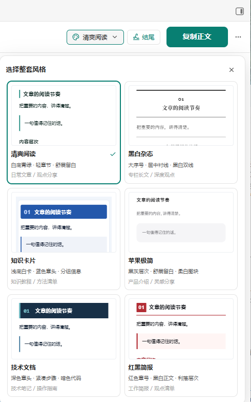
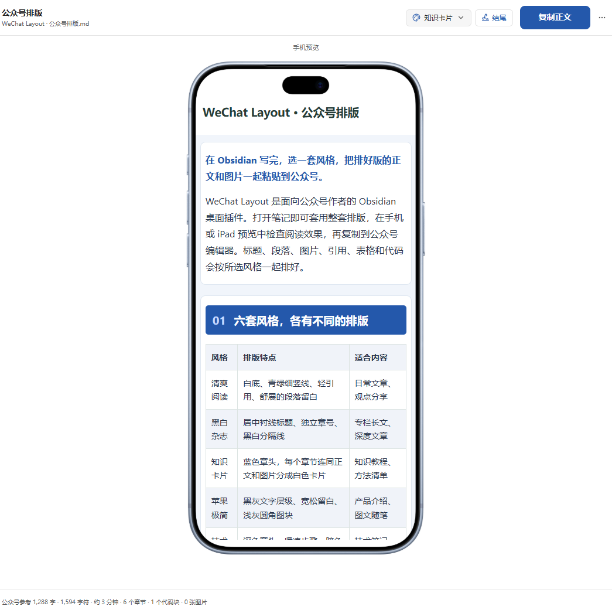
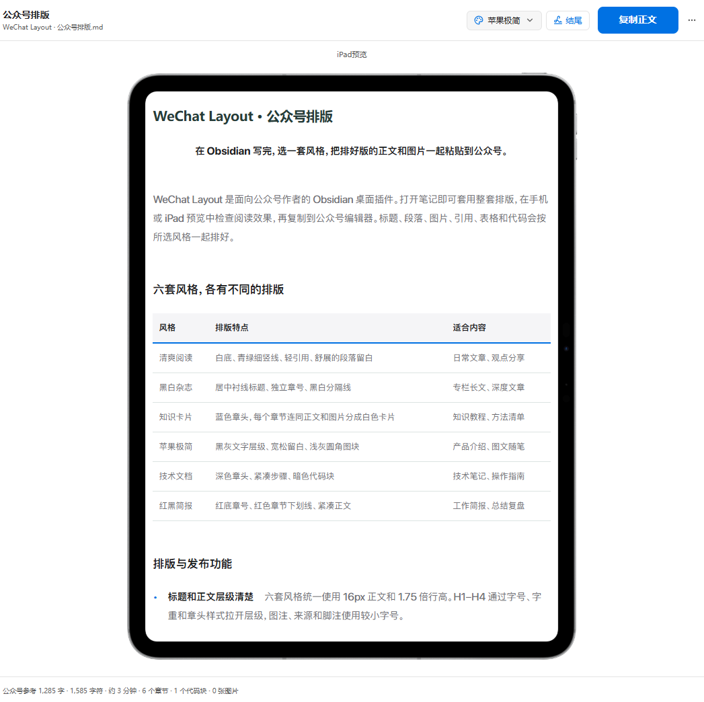

# WeChat Layout · 公众号排版

[English README](README.md)

**在 Obsidian 写完，选一套风格，把排好版的正文和图片一起粘贴到公众号。**

WeChat Layout 是面向公众号作者的 Obsidian 桌面插件。打开笔记即可套用整套排版，在手机或 iPad 预览中检查阅读效果，再复制到公众号编辑器。标题、段落、图片、引用、表格和代码会按所选风格一起排好。

## 六套风格，各有不同的排版

| 风格 | 排版特点 | 适合内容 |
| --- | --- | --- |
| 清爽阅读 | 白底、青绿细竖线、轻引用、舒展的段落留白 | 日常文章、观点分享 |
| 黑白杂志 | 居中衬线标题、独立章号、黑白分隔线 | 专栏长文、深度文章 |
| 知识卡片 | 蓝色章头，每个章节连同正文和图片分成白色卡片 | 知识教程、方法清单 |
| 苹果极简 | 黑灰文字层级、宽松留白、浅灰圆角图块 | 产品介绍、图文随笔 |
| 技术文档 | 深色章头、紧凑步骤、暗色代码块 | 技术笔记、操作指南 |
| 红黑简报 | 红底章号、红色章节下划线、紧凑正文 | 工作简报、总结复盘 |



## 排版与发布功能

- **标题和正文层级清楚**　六套风格统一使用 16px 正文和 1.75 倍行高。H1–H4 通过字号、字重和章头样式拉开层级，图注、来源和脚注使用较小字号。
- **一次复制完整图文**　支持 Obsidian 库内附件、Markdown 图片和网络图片。可用图片直接嵌入富文本，保留原来的位置。遇到缺失或读取失败的图片，会先提示具体文件。
- **手机和 iPad 两种预览**　检查标题换行、图片比例和表格在不同宽度下的阅读效果。预览、复制和 HTML 导出共用同一套文章样式。
- **风格和结尾可复用**　设置一个常用风格，也可以单独记住每篇文章的选择。署名、关注语等 Markdown 结尾可设为常用，也可只修改当前文章。
- **发布前检查与导出**　预览底部提供公众号参考字数和可展开的图片名称列表。需要留档时，可导出含内嵌图片的完整 HTML。

### 手机与 iPad 预览

**手机 · 知识卡片**



**iPad · 苹果极简**




## 安装

支持 **Obsidian 1.15.0 及以上桌面版**。

- **商店安装**　打开「设置 → 第三方插件」，搜索 **WeChat Layout**，安装后启用。 [Obsidian 插件页](https://community.obsidian.md/plugins/wechat-layout)
- **手动安装**　将 `main.js`、`manifest.json`、`styles.css` 放入笔记库的 `.obsidian/plugins/wechat-layout/`，然后启用插件。手动升级时替换这三个文件，保留 `data.json`。 [GitHub 最新发行版](https://github.com/Jackiechan24/WeChat_gzh_studio/releases/latest)

## 使用

1. 打开笔记，点击侧栏报纸图标，或从命令面板运行 **「打开公众号排版预览」**。
2. 在工具栏选择风格。通过 **「更多 → 设备预览」** 切换手机或 iPad，也可以点 **「结尾」** 添加署名。
3. 点 **「复制正文」**，在公众号编辑器的正文区域直接粘贴。文章标题填入公众号编辑器的标题栏。

**只排版一段**　先在 Markdown 编辑模式中选中内容，保持焦点在编辑器内，再从命令面板运行 **「排版当前选区」**。

## 内容支持与隐私

支持标题、加粗、斜体、删除线、多级列表、任务清单、引用、表格、代码和脚注，也支持 Obsidian 双链别名、高亮与静态 Callout。Mermaid、Dataview 和公式保留源码。笔记、块、PDF、音视频和 Canvas 嵌入需要先转成正文文字或图片。

排版、库内图片处理和 HTML 导出在本机完成，网络图片从原地址读取。插件仅在主动复制时向系统剪贴板写入当前文章的 HTML 和纯文本。

## 从源码构建

```sh
npm ci
npm test
npm run build
```

版本标签触发 [GitHub Actions](.github/workflows/release.yml) 测试、构建并生成三个发行文件的构建证明。

版权所有 (c) 赵同学AI。采用 [MIT 许可证](LICENSE)。内置依赖的许可证见 [第三方许可](THIRD-PARTY-NOTICES.md)。
